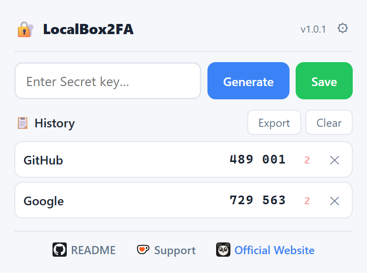

# LocalBox2FA

English | [中文](languages/README_zh.md) | [Español](languages/README_es.md) | [Deutsch](languages/README_de.md) | [日本語](languages/README_ja.md) | [Français](languages/README_fr.md)

A lightweight browser extension that generates TOTP 2FA verification codes — your secrets are generated and stored entirely on your device.

> Chromium-based · Manifest V3 · Local Processing · Privacy First

---

## Why LocalBox2FA?

Most 2FA authenticators require a phone app or cloud sync. LocalBox2FA runs directly in your browser — no phone needed, no account required, and your secrets never leave your machine.

| Advantage | Detail |
|-----------|--------|
| 🔒 **Local Only** | All TOTP computation happens in your browser using Web Crypto API. Secrets never leave your device. |
| 📱 **No Phone Needed** | Generate 2FA codes right from your browser toolbar — no mobile app required. |
| 🚫 **No Account** | No registration, no cloud sync, no login. Just install and use. |
| ⚡ **Instant** | Codes generate in under 10ms. One click to copy to clipboard. |
| 🌙 **Dark Mode** | Automatically follows your system dark mode preference. |
| 🎯 **Minimal** | No frameworks, no dependencies, no bloat. |

---

## Features

### 🆓 Free

| Feature | Description |
|---------|-------------|
| 🔐 **TOTP Code Generation** | RFC 6238 compatible — accepts secret keys from Google Authenticator, Authy, and all standard TOTP services |
| ⏱️ **30s Countdown** | Visual progress bar with color transitions (blue → orange → red) |
| 📋 **One-Click Copy** | Copy verification code to clipboard instantly |
| 💾 **Save & Manage** | Save secret keys with custom names, click to reload anytime |
| 📋 **Live History** | All saved accounts show real-time codes and countdown timers |
| 🔎 **Search & Rename** | Instantly find any account, rename accounts anytime |
| 🗑️ **Delete Single Record** | Remove individual records with confirmation dialog |
| 🔒 **Duplicate Guard** | Prevents saving the same secret key twice |
| 🌙 **Dark Mode** | Automatic dark/light theme based on system preference |
| 🌍 **6 Languages** | English, Chinese, Japanese, Spanish, German, French |

### ⭐ Premium (License Required)

| Feature | Description |
|---------|-------------|
| 📤 **Export Records** | Export all secrets as a text file (name:secret format) for backup |
| 🗑️ **Clear All Records** | Bulk delete all saved records at once |
| 📥 **Import Records** | Restore accounts from a backup text file |
| 📱 **QR Code Display** | Scannable QR code to transfer accounts to your phone authenticator |

> 💡 One-time purchase, device-bound license. [Get License →](https://www.annmax1983.com/checkout.html?plugin=localbox2fa)

---

## Compatibility Notice

This extension complies with RFC 6238 TOTP standard and supports secret keys generated by Google Authenticator, Authy and other mainstream 2FA tools. It is an independent tool and has no official affiliation with the above brands.

---

## Preview

<p align="center">
  
</p>

---

## Supported Browsers

| Browser | Status |
|---------|--------|
| Google Chrome | ✅ Fully supported |
| Microsoft Edge | ✅ Fully supported |
| Other Chromium-based browsers | ✅ Should work |

---

## Installation

1. Open your browser's extension page:
   - **Chrome**: `chrome://extensions/`
   - **Edge**: `edge://extensions/`
2. Enable **Developer mode** (top-right toggle)
3. Click **Load unpacked** and select the `local-box2-fa` folder
4. Click the 🔐 LocalBox2FA icon in your toolbar to start

---

## Usage

### Generate a Code

1. Click the LocalBox2FA icon in your toolbar
2. Paste your TOTP secret key (Base32 format) into the input field
3. Click **Generate** — a 6-digit code appears with a 30s countdown
4. Click **Copy** to copy the code to clipboard

### Save to History

1. After generating a code, click **Save**
2. Enter a name (e.g., "GitHub", "Google")
3. The account appears in your history list with a live code

### Use Saved Accounts

- All saved accounts show real-time codes and countdown timers
- Click any account to load its code into the main display
- Codes auto-refresh every 30 seconds

### Export & Backup

- Click **Export** to download all saved secrets as a `.txt` file
- Format: `AccountName:SecretKey` (one per line)
- Keep this file safe — it contains your secret keys

---

## How It Works

```
Enter secret key (Base32)
       ↓
Web Crypto API computes HMAC-SHA1
       ↓
Generates 6-digit TOTP code (RFC 6238)
       ↓
30-second countdown with auto-refresh
       ↓
One-click copy to clipboard
```

All computation happens locally using the browser's Web Crypto API. Your secrets never make a network request.

---

## Privacy

LocalBox2FA is built with privacy as a core principle:

- ✅ **Secrets stay on your device** — All TOTP computation happens locally; saved secrets never leave your browser
- ✅ **No analytics** — No tracking, no telemetry, no cookies
- ✅ **Network only for license activation** — If you activate a Premium license, your license key and a minimal device identifier are sent to the license server to verify it. Free features work fully offline and never make a network request.
- ✅ **Minimal permissions** — `storage` (to remember your license status) and access to the license server domain only

---

## ⚠️ Security Notes

**Please read carefully before use:**

- **🔑 Plaintext storage** — Secret keys are stored in the browser's extension storage (`chrome.storage.local`) **without encryption**. Anyone with access to your browser profile can view all saved keys.
- **💾 Removing the extension = data loss** — Uninstalling the extension or clearing its data will **permanently erase** all saved accounts. Please export a backup file in advance.
- **📄 Export file is unencrypted** — The exported `.txt` backup contains plaintext secret keys. Store it securely and avoid public sharing.
- **🛡️ Best practice** — Delete saved secrets from the extension after transferring them to a dedicated authenticator app.

---

## Source Code Notice

> ⚠️ **This repository does not publish source code.** It contains only usage documentation, release notes, and support resources. The extension is distributed exclusively through the Chrome Web Store. No offline installation packages or end-user source code are provided.

---

## License

Copyright © 2026 LocalBox2FA. All rights reserved.

---

## ❤️ Support

If you find LocalBox2FA helpful, consider supporting the project!

**[👉 Support LocalBox2FA](https://annmax1983.github.io/LocalBox2FA/)**
