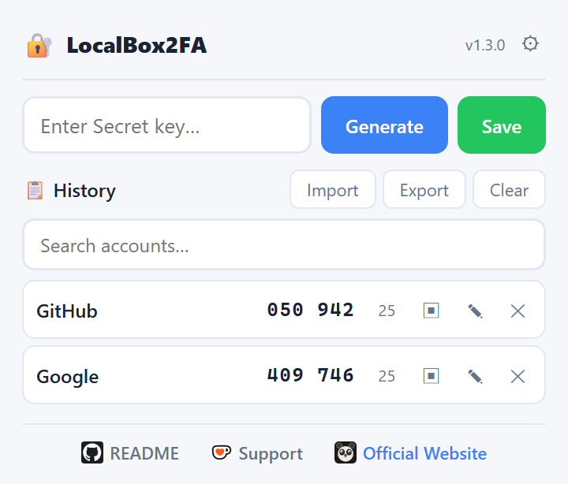

# LocalBox2FA

[English](../README.md) | [中文](README_zh.md) | [Español](README_es.md) | [Deutsch](README_de.md) | 日本語 | [Français](README_fr.md)

TOTP 方式の二段階認証コードを生成する軽量ブラウザ拡張機能です。秘密鍵は端末上で生成・使用され、拡張機能のアカウント、スマートフォンアプリ、当方のサーバーはいずれも不要です。別のパソコンでも同じアカウントを使いたい場合は、任意で暗号化同期を有効にすると、すでに使っているブラウザアカウント経由で持ち運べます。

> Chromium 系ブラウザ対応 · Manifest V3 · ローカル処理 · プライバシー最優先

---

## 機能一覧

### 🆓 無料版

| 機能 | 説明 |
|------|------|
| 🔐 **TOTP コード** | RFC 6238 準拠。Base32 の秘密鍵、または `otpauth://totp/...` の完全なリンクを貼り付けられます。6〜8 桁、独自の期間、SHA-1 / SHA-256 / SHA-512 に対応（既定値は 6 桁・30 秒・SHA-1）。HOTP には対応していません。 |
| ⏱️ **リアルタイムのカウントダウン** | 保存したアカウントごとにコードと残り時間を表示し、期間が切り替わるたびに更新します |
| 📋 **ワンクリックコピー** | 行または「コピー」ボタンを押すと、現在のコードをクリップボードにコピーします。ポップアップを開いたままコピーしてから 30 秒後にクリップボードを消去し、自動ロック時にもすぐ消去します |
| 💾 **保存と管理** | 保存時に名前を付け、一覧の検索・名前の変更・削除ができます |
| 🔒 **重複チェック** | 同じ秘密鍵は二重に保存できません。大文字小文字、空白、パディングを正規化してから比較します |
| 📱 **QR コードで移行** | **QR コードを表示**を押すと、スマートフォンの認証アプリへアカウントを移せる QR コードが現れます。既定では隠しておき、肩越しのぞき見を防ぎます |
| 🗑️ **すべて削除** | 確認のうえ、保存したアカウントをまとめて削除します |
| 🛡️ **マスターパスワード** | 保存した秘密鍵に任意の AES-GCM 256 暗号化を適用。鍵は PBKDF2-SHA256（60 万回）で導出し、メモリ上にのみ保持、ポップアップを開くたびに入力を求めます |
| 🔁 **パスワード変更** | 保存した秘密鍵をいつでも新しいマスターパスワードで再封印できます。アカウントは保持され、同期中の Vault も再暗号化されます |
| ⏲️ **アイドル自動ロック** | 暗号化が有効なとき、1／5／15 分間操作がないと自動でロックできます（既定は 5 分）。ポップアップを閉じた時点で鍵は必ずメモリから消えます |
| 📤 **エクスポート** | すべての秘密鍵を平文の `.txt` として保存するか、マスターパスワードとは独立したパスワードで暗号化した `.lb2fa` バックアップを作成します |
| 📥 **インポート** | 平文ファイル、暗号化された `.lb2fa` バックアップ、`otpauth://` リンク、Google Authenticator の移行用 QR コード、QR 画像から復元します。保存済みの重複や未対応の項目はスキップします |
| 🌙 **ダークモード** | システムのライト／ダーク設定に追従します |
| 🌍 **6 言語** | 英語、中国語、日本語、スペイン語、ドイツ語、フランス語 |

> エクスポート（平文または暗号化）、インポート、すべて削除、QR 表示は無料です。自分の秘密鍵をバックアップ・復元・削除・移行するのはデータ管理であり、有料機能ではありません。

### ⭐ Premium（ライセンスが必要）

| 機能 | 説明 |
|------|------|
| 🔄 **クロスデバイス同期** | 同じブラウザアカウントにサインインした端末間で、保存済みアカウントを任意に同期します。秘密鍵はマスターパスワードで封印して送信され、ポップアップを開いている間だけ実行、本当の競合のときだけ選択を求めます。ステータスパネルに最終同期時刻、ローカル／同期済みの件数、ストレージ使用量、保留中の競合、停止状態を表示します |

> 買い切り・永続ライセンス — 1 プラグインにつき 2 回まで有効化できます。ブラウザ環境ごとに 1 回と数え、いつでも解除して枠を空けられます。[ライセンスを取得 →](https://www.annmax1983.com/checkout.html?plugin=localbox2fa)

---

## プレビュー

  

---

## 対応ブラウザ

| ブラウザ | 状態 |
|----------|------|
| Google Chrome | ✅ 完全対応 |
| Microsoft Edge | ✅ 完全対応 |
| その他の Chromium 系ブラウザ | ✅ 動作する見込み |

---

## インストール

| ストア | リンク |
|---|---|
| Chrome ウェブストア | [Chrome に追加](https://chromewebstore.google.com/detail/hhhfdioecpkgnplkcdbcdabjodjpimem) |
| Microsoft Edge アドオン | [Edge に追加](https://microsoftedge.microsoft.com/addons/detail/mgmcahbcekbibbldnmgpeajnkphlnpin) |

> 上記の公式ストアからのみインストールしてください。第三者サイトの利用は避けてください。

---

## 使い方

### コードを生成する

1. ツールバーの LocalBox2FA アイコンを押します
2. 入力欄に Base32 の秘密鍵、または `otpauth://totp/...` の完全なリンクを貼り付けます
3. **生成**を押すと、コードとカウントダウンが表示されます
4. **コピー**を押すとクリップボードにコピーされます

Base32 の秘密鍵だけを貼り付けた場合は既定値（6 桁・30 秒・SHA-1）を使います。`otpauth://` の完全なリンクは桁数・期間・アルゴリズムを自身に含むため、既定値を使わないサービスではこちらが必要です。

### アカウントを保存する

1. コードを生成したあと**保存**を押します
2. 名前（「GitHub」「Google」など）を入力します
3. 一覧にアカウントが追加され、コードとカウントダウンが表示されます

### 保存済みアカウントを使う

- アカウントを押すと、現在のコードをコピーします
- 一覧が長いときは検索欄で絞り込めます
- 鉛筆アイコンで名前を変更、✕ アイコンで確認後に削除します
- 下部の**すべて削除**で保存済みの記録をまとめて消せます

### スマートフォンへ移行する

保存済みアカウントの ▣ アイコンを押し、**QR コードを表示**を押すと、その `otpauth://` リンクを含む QR コードが現れます。共有画面でポップアップを開いたときに見えないよう、QR は要求するまで隠れています。スマートフォンの認証アプリで読み取るとアカウントを移せます。ダイアログを閉じると QR は破棄されます。

### 秘密鍵を暗号化する

**設定（⚙）→ マスターパスワード**を開き、**暗号化を有効にする**を押します：

1. マスターパスワードを設定して確認します
2. 保存済みの秘密鍵はその場で封印されます。メタデータ（名前、桁数、期間、アルゴリズム、タイムスタンプ、ランダムな記録／端末 ID）だけが読み取れる状態で残ります
3. 以後はポップアップを開くたびに、ロック画面でパスワードを入力するまでコードは表示されません

注意：

- パスワードは**リセットも復元もできません**。忘れた場合はロック画面からすべて削除してやり直すしかないため、エクスポートしたバックアップを保管してください。
- 導出した鍵はメモリ上にのみ存在し、ポップアップを閉じると消えます。毎回入力を求めるのはそのためです。
- 封印された秘密鍵は記録に紐づきます。別のアカウントへコピーした暗号文は復号できないため、改ざんされた同期コピーで見慣れた名前を別の秘密鍵に向けることはできません。
- **暗号化を解除**すると全記録を平文に戻します。復号できない記録が 1 件でもあると操作は拒否され、該当アカウントが一覧表示され、データは一切変更されません。該当アカウントを削除してから再試行してください。
- 封印された記録は一覧で 🔐 の印が付きます。復号できない記録もコードの代わりに 🔐 を表示します。
- **アイドル自動ロック**は暗号化が有効なときだけ使えます。**設定 → セキュリティ**で**オフ**、**1 分**、**5 分**（既定）、**15 分**から選べます。指定時間操作がないと Vault がロックされ、機密ダイアログが閉じ、クリップボードも消去されます。

**マスターパスワードの変更**

**設定（⚙）→ マスターパスワード → マスターパスワードの変更**を開き、現在のパスワードと新しいパスワード（2 回）を入力します。保存済みの秘密鍵はこの端末で再暗号化され、アカウントは保持されます。同期が有効な場合はクラウドのコピーも再封印されます。他の端末は Vault の不一致を報告し、新しいパスワードを入力してクラウドのコピーを採用する（この端末のアカウントは先に消去されます）か、古いパスワードのままこの端末の Vault でクラウドのコピーを置き換えるかを選びます。どちらも自動では行われません。同期の競合がある間、または再封印が未完了の間は変更を拒否します。中断された再封印は次回の同期で再試行され、完了するまで別のマスターパスワード変更はできません。

### クロスデバイス同期（Premium）

同じブラウザアカウントにサインインしたパソコン間で、保存済みアカウントを同期します。**有効にするまでオフ**で、マスターパスワードと有効なライセンスが必要です。

**1 台目**

1. **設定（⚙）→ クロスデバイス同期**を開き、**同期を有効にする**を押します
2. 確認画面を読みます。アップロードされる件数と、ブラウザベンダーが見られる内容が表示されます
3. 確認すると、記録は封印されて `chrome.storage.sync` に書き込まれます

**2 台目**

1. ブラウザを同じアカウントにサインインし、LocalBox2FA をインストールします
2. **設定 → クロスデバイス同期 → 既存の同期に参加**を開きます
3. 1 台目と**同じマスターパスワード**を入力します

拡張機能がパスワードや導出鍵を同期することはありません。2 台目が受け取るのは Vault の salt、反復回数、検証値だけで、それでパスワードを確認し、同じ鍵でローカルの平文記録を封印します。誤ったパスワードは統合の前に拒否されます。

**統合が安全な理由**

- 記録ごとに独立した同期キーと安定した ID を持ち、削除時には明示的な削除マーカー（tombstone）を残します。キーの不在は「削除済み」を意味せず、一覧全体を書き込んで他の端末の追加を消すこともできません
- 上書きする前にクラウドの最新コピーを読み直します。その間に別の端末が変更・削除していた場合はアップロードを保留し、差分を本当の競合として提示します
- 三者比較（前回の同期状態／ローカル／リモート）で、競合しない変更は自動的に反映します
- 同じアカウントが 2 台で実際に変更されていた場合は、**この端末**、**もう一方の端末**、**両方**のどれを残すかダイアログで選びます。選択なしに上書きされることはありません
- 同期の統合時、**異なるマスターパスワード**の端末は同期済み Vault を上書きせず、Vault の不一致を報告して明示的な選択を待ちます
- 同じ Vault を共有する端末は同じ拡張機能バージョンに揃えてください。古いバージョンは現在の封印形式を認識できず、古いコピーで記録を置き換える可能性があります

**補足**

- 同期パネルには、最後に成功した同期、ローカルと同期済みのアカウント数、ブラウザの同期クォータの使用状況（バイト数と項目数）、保留中の競合、停止／エラー状態が表示されます。停止バッジが出ている場合は、下のメッセージに対処するまで同期は進みません。
- 同期はポップアップを開いたとき（ロック解除後）と、別の端末がデータを変更したときに実行されます。「今すぐ同期」ボタンはありません
- 同期をオフにしてもクラウドのコピーは他の端末のために残ります。同じパネルの**同期データを削除**でブラウザアカウントから削除できます。他の端末はローカルのアカウントを保持し、クラウドのコピーが消えたことを検知すると同期をオフにします
- 同期が有効な間は暗号化を解除できません。平文の記録は決してアップロードされないためです
- ライセンスキーは同期されません。端末ごとに有効化してください
- データはブラウザアカウントの同期サービス（ブラウザに応じて Google または Microsoft）が転送します。アカウント名と TOTP 設定はそのサービスから読めますが、秘密鍵は AES-GCM とマスターパスワードで封印されます。転送自体も端末間で暗号化したい場合は、ブラウザの同期パスフレーズを有効にしてください（Chrome：*同期と Google サービス → 暗号化オプション*）
- ブラウザの同期クォータ（合計約 100 KB、1 項目 8 KB）が適用されます。記録を黙って捨てることはせず、クォータエラーとして報告します

### エクスポートとインポート

**エクスポート**

**エクスポート**を押し、2 つの形式から選びます：

- **暗号化バックアップ** — AES-GCM 256 で暗号化した `.lb2fa` ファイルをダウンロードします。ここで設定するバックアップ用パスワードはマスターパスワードとは独立しており、復元時に必要な唯一の鍵です。ファイル自体が完結しているため、Vault のパスワードを変更した後や忘れた後でもアカウントを復元できます。
- **平文** — 1 行 1 件の `アカウント名:秘密鍵`、または桁数・期間・アルゴリズムが既定値と異なる場合は `アカウント名:otpauth://…` を並べた `.txt` ファイルをダウンロードします。開いた人は誰でも読め、マスターパスワードでは保護されません。

**インポート**

**インポート**を押し、次のいずれかを選びます：

- 平文の `.txt` バックアップ
- 暗号化された `.lb2fa` バックアップ — 形式を自動判定し、バックアップ用パスワードを求めます
- `otpauth://` の QR コード、Google Authenticator の移行用 QR コード（`otpauth-migration://offline?data=…`）、または Base32 の秘密鍵や `otpauth://` リンクを含むテキストのファイル／画像

保存済みの秘密鍵はスキップされます。HOTP や未対応の項目もスキップされ、件数として報告されます。Google Authenticator の分割エクスポートは、QR 画像を 1 枚ずつインポートしてください。取り込み済みのアカウントはスキップされます。

---

## 動作の仕組み

1. 設定キー（Base32 の秘密鍵）を入力するか、otpauth:// リンクを貼り付けます。
2. コードはブラウザ内蔵の暗号機能を使って端末上で生成されます。
3. 6〜8 桁のコードが表示され、カウントダウンに応じて自動で更新されます。
4. ワンクリックでクリップボードにコピーされます。

計算はすべてブラウザの Web Crypto API を使ってローカルで行われます。コード生成でネットワーク通信が発生することはありません。保存データが端末の外に出るのは、暗号化されたクロスデバイス同期を明示的に有効にしたときだけです。

---

## プライバシーと権限

- **既定はローカル** — 保存した秘密鍵は `chrome.storage.local` にあり、同期を有効にしない限り端末の外に出ません
- **任意の暗号化** — マスターパスワードを設定しない場合、秘密鍵は平文です。有効にすると各秘密鍵を AES-GCM 256 で封印し、鍵はパスワードから導出（PBKDF2-SHA256、60 万回）してメモリ上にのみ保持します
- **同意した場合のみ同期** — 封印された記録、アカウント名、TOTP 設定、Vault の salt／反復回数／検証値が `chrome.storage.sync` に書き込まれ、ブラウザアカウントが転送します。マスターパスワードとライセンスキーは決して含まれません
- **解析なし** — トラッキング、テレメトリ、Cookie、第三者スクリプトはありません
- **ページへのアクセスなし** — コンテンツスクリプトはなく、履歴・タブ・ブックマークにもアクセスしません
- **最小限の通信** — ライセンスがない場合、拡張機能はネットワーク通信を行いません（オフライン中に予約された解除の再試行だけが例外です）。ライセンスがある場合は `api.annmax1983.com` に接続し、有効化・再検証（ポップアップを開いたとき 2 時間に最大 1 回）・解除を行います。これらのリクエストにはライセンスキー、ランダムなインストール ID、ブラウザのメタデータ（ブラウザ名／バージョン、言語、タイムゾーン、User-Agent）が含まれますが、秘密鍵や生成したコードは含まれません
- **最小限の権限** — `storage` と `clipboardWrite`、およびライセンスサーバーのドメインへのアクセスだけです。`clipboardWrite` はコードをコピーし、あとで消去するために使います。クリップボードを読み取ることはできず、ページへのアクセス権も与えません。同期によって権限は増えず、当方のサーバーも使いません

項目ごとの詳細は [privacy-policy.html](../privacy-policy.html) を参照してください。

---

## ⚠️ セキュリティに関する注意事項

- **暗号化は任意です** — 初期状態では秘密鍵は拡張機能のローカルストレージに暗号化されずに保存されます。ブラウザプロファイルにアクセスできる人は誰でも読めます。設定でマスターパスワードを有効にして封印してください。
- **パスワードは復元できません** — マスターパスワードはリセットできず、封印された記録はパスワードなしでは復元できません。忘れた場合はロック画面からすべて削除するしかありません。エクスポートしたバックアップを保管し、暗号化形式を選んでそのバックアップ用パスワードを別に保管してください。バックアップ用パスワードも復元できません。
- **拡張機能の削除はローカルデータの消失** — アンインストールやローカルストレージの消去は、この端末の全アカウントを完全に削除します。同期が有効ならブラウザアカウントにコピーが残り、再インストール後にライセンスを再有効化し、同じマスターパスワードで既存の同期に参加すれば復元できます。完全に消したい場合は先に**同期データを削除**してください。
- **同期はバックアップではありません** — 削除も同期されます。ある端末でアカウントを削除すると他の端末でも削除されます。作り直せないものはエクスポートして保管してください。
- **ブラウザアカウントへの信頼** — 同期データはブラウザベンダーの同期サービスが転送します。秘密鍵はマスターパスワードで封印されますが、アカウント名と TOTP 設定は封印されません。ブラウザアカウント*と*マスターパスワードの両方にアクセスできる人は秘密鍵を読めます。転送自体も暗号化するにはブラウザの同期パスフレーズを有効にしてください。
- **エクスポート形式に注意** — 平文の `.txt` バックアップは開いた人が読めるため、機密情報として扱い共有しないでください。暗号化された `.lb2fa` バックアップはエクスポート時に設定したパスワードで封印され、マスターパスワードとは独立しています。
- **画面とクリップボードは漏れる** — QR コードは**QR コードを表示**を押すまで隠れ、コピーしたコードはコピーから 30 秒後（または自動ロック時）にクリップボードから消え、アイドル自動ロックは解除状態が画面に残る時間を制限します。ポップアップを閉じると派生キーは破棄されますが、閉じる直前にコピーしたコードは通常のコピーと同様にシステムのクリップボードに残ります。いずれも侵害されたコンピューターを守るものではありません。
- **推奨事項** — 専用の認証アプリに移した秘密鍵は、拡張機能から削除してください。

---

## 互換性

LocalBox2FA は RFC 6238 TOTP を実装し、Google Authenticator、Authy などの一般的な 2FA ツールが生成する秘密鍵を受け付けます。独立したツールであり、これらのブランドとの公式な提携関係はありません。

---

## ソースコードに関する注意

> ⚠️ **このリポジトリはソースコードを公開していません。** 利用方法のドキュメント、リリース情報、サポート情報のみを掲載しています。拡張機能は Chrome ウェブストアでのみ配布され、オフラインインストール用パッケージやエンドユーザー向けソースコードは提供しません。

---

## ライセンス

Copyright © 2026 LocalBox2FA. All rights reserved.

---

## ❤️ サポート

LocalBox2FA が役に立ったら、ぜひプロジェクトを支援してください！

**[👉 LocalBox2FA を支援する](https://annmax1983.github.io/LocalBox2FA/)**
